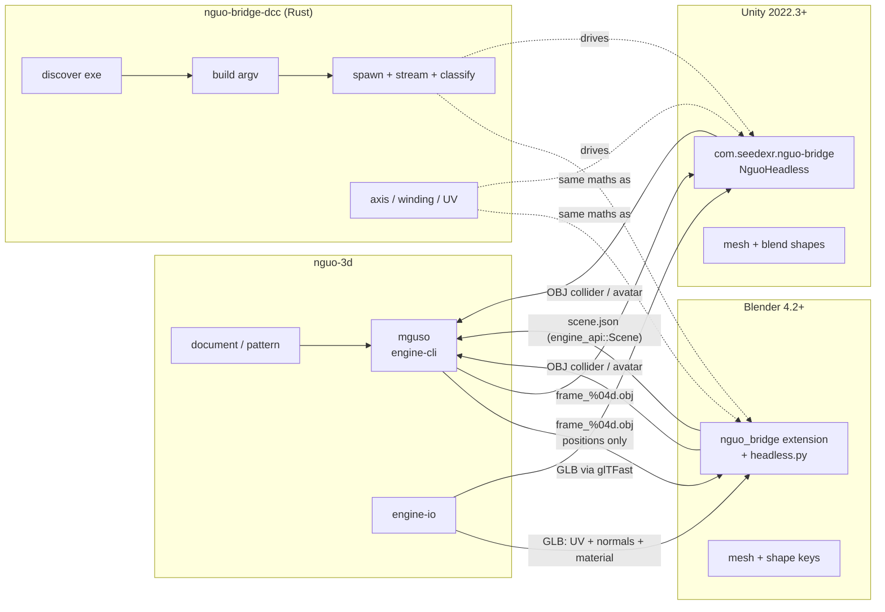

<!-- SPDX-License-Identifier: GPL-2.0-or-later -->
# INTEROP.md — nguo-3d ↔ Blender / Unity

How a garment draped in nguo-3d gets into a DCC and back, what format it
travels in, which axis convention it is in at each hop, what each DCC does with
it, and where the round trip stops being lossless.

Everything below was **observed on 2026-08-01** — a command run or a file read —
not recalled. Version pins for the observations: **Blender 5.2.0 LTS**
(`/Applications/Blender.app/Contents/MacOS/Blender`), **Unity 6000.4.8f1**
(`/Applications/Unity/Hub/Editor/6000.4.8f1/…`), engine binary `mguso` from
`core-engine/crates/engine-cli`.

## 0. Status: what is verified, what is not

| Path | Status |
|---|---|
| nguo → Blender, single mesh (OBJ/GLB) | **verified** — `bridges/blender/tests/smoke.py`, 11/11 |
| nguo → Blender, animated sequence (shape keys) | **verified** — smoke test + a real 20-frame drape |
| Blender → nguo collider (OBJ) | **verified** — axis agreement asserted against Blender's own exporter |
| Blender → `mguso` → Blender, full round trip | **verified** — ran end to end, 169-vertex pinned cloth vs a sphere, 20 frames |
| Axis / winding / UV maths, both DCCs | **verified in Rust** — 31 unit + 4 integration tests in `nguo-bridge-dcc`, including nguo→DCC→nguo identity for positions, normals, UVs and winding |
| Unity C# compiles | **verified outside Unity** — Roslyn (`dotnet` 10.0.203, C# 9), all of `Editor/` + `Tests/Editor/`, 0 errors 0 warnings, against minimal Unity stubs |
| Unity axis / winding / UV / OBJ round trip | **verified outside Unity** — all 6 `NguoAxisTests` run green against those stubs |
| nguo → Unity **inside Unity** (AssetDatabase, blend shapes, batchmode entry) | **UNVERIFIED** — Unity is installed here but **has no activated licence**; every headless run exits **198** with `No valid Unity Editor license found` |
| Unity → nguo collider, inside Unity | **UNVERIFIED**, same reason |

So the Unity maths and the code's compilability are real results, not claims.
What has never run is the part that needs the Editor itself: `AssetDatabase`,
`Mesh.AddBlendShapeFrame`, `SkinnedMeshRenderer`, and `-executeMethod` dispatch.
`bridges/unity/Tests/Editor/NguoAxisTests.cs` re-runs the maths inside Unity for
anyone with a licence; `unity_selftest_passes` in
`ui/crates/nguo-bridge-dcc/tests/dcc_installed.rs` drives it end to end and
currently skips with the licence reason printed.

## 1. Data flow



## 2. Formats — and why these and no others

`engine-io` **reads** OBJ, STL, glTF/GLB, USD (`.usda`/`.usdc`/`.usdz`),
COLLADA and FBX (`engine-io/src/lib.rs:31` `load_mesh`). It **writes** only
three: OBJ (`save_obj`), STL (`save_stl`) and GLB (`save_glb`). There is no FBX,
USD or COLLADA *writer*. That single fact decides every format choice here — the
lazy ladder says reuse what exists rather than write a fourth exporter.

| Leaving nguo as | Carries | Used for |
|---|---|---|
| **GLB** (`engine_io::save_glb`) | positions, `NORMAL`, `TEXCOORD_0`, material, skin/animation | a single draped garment with its UVs and materials |
| **OBJ sequence** (`mguso run --out DIR`) | positions + triangles **only** | the animated drape; `write_obj` (obj.rs:92) emits `v` and `f` lines and nothing else |
| **OBJ** (from the DCC, inbound) | positions, UVs, normals | collider / avatar target for the solver |
| **`scene.json`** (`engine_api::Scene`) | meshes + fabric preset + pins + solver config | what the Blender bridge hands `mguso` |

**Unity, glTF or FBX?** glTF. Not a preference — `save_glb` is the only
material-carrying writer `engine-io` has, and FBX there is read-only. Unity has
no native glTF importer, so the GLB path needs Unity's own
`com.unity.cloud.gltfast` package, which ships a `ScriptedImporter` for
`.gltf`/`.glb`: add the package, drop the file in `Assets/`, done — the bridge
deliberately contains **no** GLB code of its own. The always-available path,
with no package at all, is the OBJ sequence, which is what the animated case
needs anyway.

## 3. Axis conventions — the part that silently mirrors garments

### The three spaces

| | handedness | up | forward | right | UV origin |
|---|---|---|---|---|---|
| **nguo-3d** | right | +Y | +Z | −X | top-left (v down) |
| **Blender** | right | +Z | −Y | +X | bottom-left |
| **Unity** | **left** | +Y | +Z | +X | bottom-left |

nguo space *is* glTF space. Evidence: default gravity is `[0.0, -9.8, 0.0]`
(`engine-api/src/params.rs:99`), and `engine-io`'s glTF writer stores positions,
normals and UVs verbatim — `gltf_io.rs:326` `write_glb`, and the reader is
commented "UVs (TEXCOORD_0), untransformed" at `gltf_io.rs:161`. Since nguo
round-trips through its own glTF I/O unchanged, its space is glTF's by
construction. glTF 2.0 declares +Y up, **+Z forward**, −X right.

### nguo ↔ Blender — a rotation

```
        ⎡ 1  0  0 ⎤                    ⎡ 1  0  0 ⎤
M_n→b = ⎢ 0  0 -1 ⎥   det = +1   M_b→n = ⎢ 0  0  1 ⎥   det = +1
        ⎣ 0  1  0 ⎦                    ⎣ 0 -1  0 ⎦

    blender = ( n.x, -n.z,  n.y )        Rx(-90°)
    nguo    = ( b.x,  b.z, -b.y )        Rx(+90°)
```

Measured, not derived: Blender 5.2.0's `bpy.ops.wm.obj_export` at its defaults
(`forward_axis='NEGATIVE_Z'`, `up_axis='Y'`) exported the three Blender basis
vertices as

```
    blender (1,0,0) → file (1, 0,  0)
    blender (0,1,0) → file (0, 0, -1)
    blender (0,0,1) → file (0, 1,  0)
```

`det = +1`, so **handedness is preserved and triangle winding is untouched**.
Because those defaults already produce nguo space, the Blender bridge does not
override the axis arguments on export — overriding them is how you break it.

### nguo ↔ Unity — a mirror

```
        ⎡-1  0  0 ⎤
M_n→u = ⎢ 0  1  0 ⎥   det = -1     unity = (-n.x, n.y, n.z)
        ⎣ 0  0  1 ⎦

M_u→n = M_n→u                      negating X is an involution
```

Negate **X**, not Z. glTF declares +Z forward and −X right; Unity declares +Z
forward and +X right, so negating X is the map that keeps "up" and "forward"
meaning the same thing. It is also what Unity's own glTFast (≥ 5.0) does — it
changed from negate-Z to negate-X precisely to honour the spec — so the GLB path
and the OBJ path agree.

`det = -1`. Three consequences, none of them optional:

1. **Triangle winding must be reversed** (`[a,b,c] → [a,c,b]`), or the garment
   renders inside-out. This is the classic silent interop bug.
2. **Normals go through the same matrix.** Both matrices here are orthogonal, so
   `M⁻ᵀ == M` and one function serves positions and normals.
3. The mirror negates a triangle's *geometric* normal and the winding flip
   negates it back — so it is only the **pair** (flip winding **and** transform
   the shading normal) that leaves shading normal and geometric normal on the
   same side. Doing one without the other is worse than doing neither.

`nguo_bridge_dcc::axis::convert_mesh` and `NguoAxis.ConvertMesh` each do all
four (positions, normals, UVs, winding) in one call. Prefer them over the
per-element functions; getting three of four right is exactly how this bug ships.

### UVs

glTF — and therefore nguo — puts the UV origin **top-left**, v growing down.
Blender and Unity both put it **bottom-left**. Both directions are `v → 1 − v`,
in both bridges.

### Tests that hold this down

`ui/crates/nguo-bridge-dcc/src/axis.rs`:

* `blender_basis_matches_measured_obj_export` — the exact triple above.
* `round_trip_positions_and_normals_are_identity`, `round_trip_uvs_are_identity`,
  `round_trip_winding_is_identity` — nguo → DCC → nguo is the identity.
* `full_mesh_round_trip_nguo_dcc_nguo` — all four at once.
* `converted_mesh_faces_the_same_way_it_did_before` — after conversion the
  geometric normal still agrees with the shading normal, for **both** DCCs.
* `unity_without_winding_flip_is_inside_out` — proof the previous assertion has
  teeth: skip the flip and it really does invert.
* `handedness_is_what_we_claim` — `det(M_n→b) = +1`, `det(M_n→u) = −1`.

Mirrored on the Blender side by `smoke.py::axis_round_trip` and
`axis_matches_blenders_own_obj_exporter` (which cross-checks our Python against
Blender's own exporter), and on the Unity side by `NguoAxisTests`.

## 4. Headless commands

### Blender

```
blender --background --factory-startup --python-exit-code 47 \
        --python bridges/blender/headless.py -- <subcommand> [options]
```

Built by `nguo_bridge_dcc::blender_argv`, asserted argv-exact in
`blender_argv_is_exact`. Notes:

* Blender processes arguments **in order** — `--python-exit-code` must precede
  `--python`, and everything after the bare `--` is left for the script.
* `--factory-startup` is deliberate: a user's add-ons and preferences must not
  change a CI result.
* `--python-exit-code 47` turns an uncaught Python exception into exit **47**,
  which `nguo_bridge_dcc` maps to `BridgeError::Script` — distinguishable from
  Blender itself dying.

Subcommands:

| | |
|---|---|
| `selftest` | register the add-on, report its operators |
| `import-glb --path X.glb [--save out.blend]` | drape result with UVs + materials |
| `import-sequence --dir DIR [--target OBJ] [--save out.blend]` | frame sequence → shape keys |
| `export-collider [--object NAME]… --out X.obj` | Blender mesh → nguo collider |
| `scene --cloth NAME [--collider NAME]… --fabric F --frames N --out scene.json` | build the engine scene, do not solve |
| `drape --cloth NAME [--collider NAME]… --fabric F --frames N --work DIR [--save out.blend]` | the whole round trip |

The extension itself lives in `bridges/blender/nguo_bridge/` and validates with
`blender --command extension validate bridges/blender/nguo_bridge`
(→ `Success parsing TOML`). The N-panel is in the 3D viewport under the
**nguo-3d** tab and calls the same functions.

### Unity

```
Unity -batchmode -nographics -quit -logFile - \
      -projectPath <p> -executeMethod Seedexr.Nguo.Bridge.NguoHeadless.<M> \
      --key value …
```

Built by `nguo_bridge_dcc::unity_argv`, asserted argv-exact in
`unity_argv_is_exact`. Flags and semantics from Unity's *Editor command line
arguments* reference (<https://docs.unity3d.com/Manual/EditorCommandLineArguments.html>):

* `-batchmode` — "Unity runs command line arguments without the need for human
  interaction"; on an uncaught exception Unity "immediately exits with return
  code 1".
* `-nographics` — does not initialise the graphics device. **"Output logs are
  turned off in this mode. To enable the creation of output logs, specify a file
  location using `-logFile`."** That is why `-logFile -` is not optional: it is
  the only way the run is observable at all. `unity_argv_always_carries_logfile_because_nographics_mutes_output`
  guards it.
* `-quit` — quit once the other commands finish.
* `-executeMethod <Class.Method>` — a **static** method run after the project
  opens. "To return an error from the command line process, either throw an
  exception … or call `EditorApplication.Exit` with a non-zero return code."
* Unity has no first-class parameter passing to that method; extra arguments are
  appended verbatim and read back with `System.Environment.GetCommandLineArgs()`
  — also per that reference.

Methods: `SelfTest`, `ImportMesh --path X.obj [--asset …]`,
`ImportSequence --dir DIR [--fps 30] [--vertex-limit N] [--asset …]`,
`ExportCollider --out X.obj [--object NAME]`.

### Getting an answer back out

Both bridges print exactly one line

```
NGUO-BRIDGE-RESULT: {…json…}
```

`nguo_bridge_dcc::parse_result` takes the **last** such line out of the merged
stdout+stderr stream. A sentinel is the only robust option: Unity in batch mode
emits hundreds of log lines around whatever you asked for.

### Exit codes

| DCC | code | meaning | `BridgeError` |
|---|---|---|---|
| both | 0 | success | — |
| both | (signal) | killed | `Killed` |
| Blender | 47 | our Python raised | `Script` |
| Blender | other ≠ 0 | Blender itself failed | `Dcc` |
| Unity | 1 | Unity's own "an exception occurred" | `Dcc` |
| Unity | 2 | bad arguments (ours) | `Script` |
| Unity | 3 | the operation failed (ours) | `Script` |
| Unity | **198** | `No valid Unity Editor license found` | `NoLicence` |

198 is not from the manual — it is what Unity 6000.4.8f1 actually did on this
machine. It gets its own variant because it is the single most common way a
headless Unity run dies in CI and "exit 198" tells nobody anything.

## 5. Round-trip guarantees, and their limits

**Guaranteed.**

* Positions, normals, UVs and winding survive nguo → DCC → nguo **exactly** —
  every matrix is a signed permutation of the basis, so the arithmetic is
  bit-exact in `f32`, no epsilon needed. Asserted with `assert_eq!`, not
  `approx`.
* A garment that faces outwards in nguo faces outwards in both DCCs.
* Topology (vertex order and triangle indices) is preserved end to end; the
  solver never remeshes, which is what makes shape keys and blend shapes work.
* `mguso` is deterministic, so the same submission gives the same frames.

**Not guaranteed — read this before filing a bug.**

1. **The OBJ frame sequence carries positions and triangles only.** `write_obj`
   emits no `vt`, no `vn`, no `mtl`. UVs and materials must come from the GLB or
   from the object the sequence is applied to. Both bridges therefore offer
   "apply the sequence to this existing object" as well as "make a new one".
2. **`mguso` welds every scene object into one vertex space** and writes them
   all into each frame, so a drape against a collider arrives as
   cloth **+** collider in one mesh. Both bridges slice off the leading *n*
   vertices — the cloth, which the scene builder always emits first
   (`n_verts` / `vertexLimit`). Importing a raw frame directory without that
   hint gives you the welded blob.
3. **Blender's per-loop UVs are collapsed to per-vertex** on export, because
   `engine_api::Object.uvs` is per-vertex. `mesh_to_nguo` takes the first loop
   touching each vertex, which **silently welds UV seams**. Fine for a collision
   proxy and for a garment whose UVs came from nguo in the first place; split the
   vertices first if a seamful DCC mesh has to round-trip.
4. **Materials are one-way.** GLB carries a material out of nguo; nothing carries
   a DCC material back in — `engine_api::Material` is a *physical* fabric
   description (membrane stiffness, bend, areal density), not a shading one.
   Fabric choice travels as a named `FabricPreset`, not as numbers.
5. **Object transforms are baked.** nguo has no scene graph, so both bridges bake
   to world space on the way out. The transform does not come back.
6. **No mesh-sequence cache.** Alembic and USD are the formats for that and
   `engine-io` writes neither. Shape keys (Blender) and blend shapes (Unity) are
   what we use; they cost one full vertex array per frame, which is fine for the
   frame counts a drape produces and is not fine for thousands.
7. **Unity blend shapes are imported but not wired to an Animator.** The
   `AnimationClip` is produced and saved; assigning it to an Animator Controller
   is one drag in the Editor and a pile of `AnimatorController` API in script.

## 6. Licensing

* `ui/crates/nguo-bridge-dcc/**` and `bridges/unity/**` — **GPL-2.0-or-later**,
  like the rest of nguo-3d.
* `bridges/blender/**` — **GPL-3.0-or-later**. Two reasons: Blender add-ons must
  be GPL regardless, and this add-on's *structure* follows ClothDrop Reborn
  (GPL-3.0-or-later, read as a reference in a local working tree, not
  redistributed here) —
  the extension manifest, the flat `classes` list registered from `__init__.py`,
  the `VIEW_3D`/`UI`/`bl_category` N-panel registration, the operator layout and
  the preset table. No ClothDrop code was copied into the Rust tree.
* The `blender_manifest.toml` field set was additionally cross-checked against
  the ZOZO `ppf_contact_solver` extension (Apache-2.0) installed under Blender
  5.2 on this machine — read as a reference for the modern manifest shape, not
  copied.
